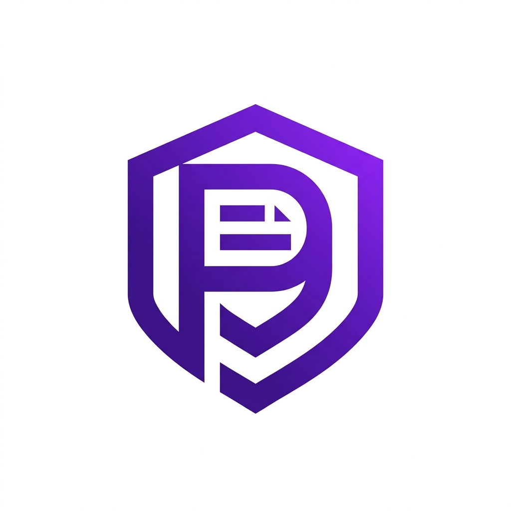
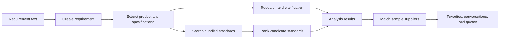

<p align="center">
  
</p>

<h1 align="center">Procure</h1>

<p align="center">
  <strong>Turn procurement requirements into structured analysis, standards matches, and supplier insights.</strong>
</p>

<p align="center">
  An AI-assisted procurement and Indian Standards intelligence prototype.
</p>

<p align="center">
  <a href="https://procure2-delta.vercel.app/">View the live demo</a>
</p>

<p align="center">
  
  
  
  
  
  
</p>

## Overview

Procure is a demonstration web application for exploring how a plain-language procurement requirement can be turned into structured product details, candidate Indian Standards, and sample supplier recommendations. It combines local, bundled reference data and deterministic matching with optional Gemini-powered extraction, research, and standards ranking.

This repository is a prototype, not an authoritative procurement or compliance service. Its bundled standards and supplier records are limited sample data, and AI-generated information may be incomplete or incorrect. Verify current standards, amendments, certifications, and regulatory requirements with official sources before making procurement decisions.

## Key features

- **Requirement analysis:** Enter a procurement need in text and extract details such as product, quantity, use case, and technical requirements.
- **Standards matching:** Search and rank candidate standards from the local data set using keyword-based matching; optional Gemini ranking can refine the order.
- **Research and clarification:** View a structured research summary, procurement checklist, clarification questions, and verification caveats. AI-researched standards are marked for verification.
- **Supplier recommendations:** Review sample suppliers matched and scored against the requirement and its matched standards.
- **Supplier follow-up:** Save favorites, open supplier conversations, exchange demo messages, and submit a quote through the demo workflow.
- **Voice input:** Dictate a requirement using browser speech recognition where supported.

> **Prototype limitations:** The dashboard's file picker does not upload or parse the selected document; analysis runs on the text in the input field. Supplier replies are generated by demo logic, and the sign-in/verification experience is not production authentication.

## Technology stack

| Area | Technologies |
| --- | --- |
| Web application | Next.js 16 App Router, React 19 |
| Language | TypeScript 5 |
| Styling | Tailwind CSS 4 |
| Data and persistence | Prisma with a SQLite schema; file-backed JSON fallback |
| AI integration | Google Generative AI SDK (Gemini, optional) |
| UI and motion | Radix UI, Phosphor Icons, Lucide, Framer Motion, GSAP |

## Screenshots

No application screenshots are currently committed. The repository includes the Procure logo (`public/procure-logo-new.png`); you can also explore the [live demo](https://procure2-delta.vercel.app/).

## Workflow and architecture



The main workflow is implemented in the Next.js App Router:

1. The dashboard sends requirement text to the requirements API.
2. The analysis page extracts structured fields. Gemini is used when `GEMINI_API_KEY` is configured; deterministic local extraction and research are used otherwise or when a Gemini request fails.
3. Procure searches its bundled standards records and ranks the returned candidates. Gemini ranking is optional; keyword-based ranking is the fallback.
4. The results link to sample supplier matches, where users can save a favorite, start a conversation, and submit a quote.

The UI and API routes live in `src/app/`, shared components in `src/components/`, and data and analysis helpers in `src/lib/`. Bundled standards and supplier records are in `src/lib/standards/data/`.

## Installation and setup

### Prerequisites

- Node.js 20 or newer and npm
- A Google Gemini API key only if you want to enable Gemini-backed analysis

### Install

```bash
git clone https://github.com/harshalbagul725-source/procure.git
cd procure
npm install
```

Copy the example environment file to `.env`:

```powershell
Copy-Item .env.example .env
```

On macOS or Linux, use:

```bash
cp .env.example .env
```

The example file sets `DATABASE_URL` to a local SQLite database. Add a Gemini key to enable Gemini-backed analysis:

```dotenv
DATABASE_URL="file:./dev.db"
GEMINI_API_KEY="your_google_ai_studio_key"
```

`GEMINI_API_KEY` is optional. Without it, the application uses deterministic local extraction, research, and standards ranking.

The repository includes a Prisma schema and a JSON-backed fallback, but no Prisma migration or database-bootstrap script. It does not provide a database setup command.

## Run the project

Start the development server:

```bash
npm run dev
```

Open [http://localhost:3000](http://localhost:3000). The landing page links to the demo portal and requirement dashboard.

Available npm scripts:

```bash
npm run dev    # Start the development server
npm run build  # Build for production
npm run start  # Start the production server after building
npm run lint   # Run ESLint
```

## Environment variables

| Variable | Required | Purpose |
| --- | --- | --- |
| `DATABASE_URL` | For Prisma-backed storage | Database connection URL. `.env.example` uses a local SQLite file. |
| `GEMINI_API_KEY` | No | Enables Gemini-backed requirement understanding, research, and candidate ranking. Deterministic local paths are used without it. |

## Project structure

```text
.
├── prisma/
│   ├── dev.json                 # JSON-backed demo data store
│   └── schema.prisma            # SQLite data model
├── public/                      # Logos and static assets
├── src/
│   ├── app/
│   │   ├── api/                 # Requirement, supplier, favorite, and conversation APIs
│   │   ├── analysis/[id]/       # Requirement understanding and results
│   │   ├── conversations/       # Supplier conversations and quotes
│   │   ├── dashboard/           # Requirement entry point
│   │   └── suppliers/           # Supplier views
│   ├── components/              # Landing, layout, and shared UI
│   └── lib/
│       ├── ai/                  # Requirement understanding and ranking
│       └── standards/           # Standards lookup and bundled reference data
├── .env.example
├── package.json
└── README.md
```

## Future improvements

Potential next steps—not current capabilities—include:

- Implement document upload and tender-file extraction.
- Add production authentication and role-based access control.
- Expand the standards and supplier data and define a robust verification and update process.
- Add automated tests for requirement analysis, matching, and API workflows.
- Document and validate a complete Prisma database provisioning and migration workflow.

## Contributing

Contributions are welcome. Open an issue to discuss a change, then submit a focused pull request with a clear description. Before opening a pull request, run:

```bash
npm run lint
npm run build
```

There is currently no test script defined in `package.json`.
